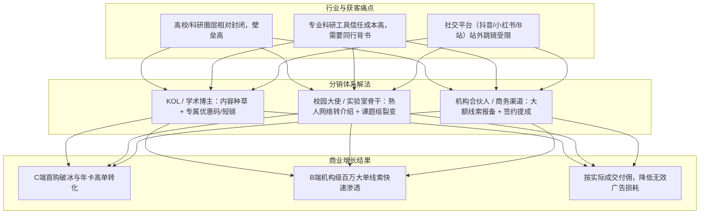

# 立理 S1 合伙人分销系统：项目背景与业务上下文

> **文件版本**：V1.0  
> **整理时间**：2026-11-03  
> **关联输入**：
> - [立理 S1 套餐与加油包产品需求文档.md](file:///Users/chidaoyinhe/Documents/工作文件/S1/S1文档/立理 S1 套餐与加油包产品需求文档.md)
> - [LitLit S1 产品边界与架构上下文.md](file:///Users/chidaoyinhe/Documents/工作文件/S1/S1文档/LitLit S1 产品边界与架构上下文.md)

---

## 一、 产品定位与核心业务大盘

### 1.1 产品定义与目标用户
- **产品定义**：**立理 S1（LitLit S1）** 是面向**科研与知识工作场景**的高性能 Agent 工作台。
- **交付核心**：自然语言任务交互、Agent 编排与工作流（Skills/Workflows）、隔离执行沙箱（如阿里云 Agent Sandbox）、持久化存储（AgenticFS/云存储）、多模型路由与计算产物交付。
- **核心客群画像**：
  1. **高校与科研院所人员**：研究生、博士生、高校教师、重点实验室负责人（PI）、科研项目团队。
  2. **知识密集型企业专业人士**：行业分析师、咨询顾问、数据科学家、独立学者。
  3. **机构与组织级客户**：高校课题组、重点实验室、学院院系、科研院所。

---

## 二、 现有商业化体系梳理（分销标的物）

分销系统的佣金计算模型、推广策略和结算规则，均以现有的商业化定价与履约为基准：

### 2.1 个人 C 端线上付费体系

| 商品类别 | 档位 | 定价规则 | 核心交付权益 | 商业与推广特征 |
| :--- | :--- | :--- | :--- | :--- |
| **月卡** (自然月周期，不自动续费) | **Lite** | 首购 ¥99 / 续购 ¥169 | 11,000 积分 / 5GB 存储 / 3 并发 | 低门槛“破冰单”，首购吸引力强 |
| | **Pro** | 首购 ¥299 / 续购 ¥369 | 36,000 积分 / 15GB 存储 / 5 并发 | 科研工作主力档，高转化率 |
| | **Max** | 首购 ¥999 / 续购 ¥1,169 | 125,000 积分 / 50GB 存储 / 10 并发 | 高客单重度算力档 |
| **年卡** (12自然月，按月发放积分，不自动续费) | **Lite** | ¥999 / 年 | 132,000 积分 (1.1万/月) / 5GB / 3 并发 | 锁定长期用户，单笔客单价高 |
| | **Pro** | ¥2,999 / 年 | 432,000 积分 (3.6万/月) / 15GB / 5 并发 | 高佣金潜力核心年卡 |
| | **Max** | ¥9,999 / 年 | 1,500,000 积分 (12.5万/月) / 50GB / 10 并发 | 万元超大单，极高分佣空间 |
| **增值加油包** (按需充值，12个月有效) | 6 档可选 | ¥90 ~ ¥3,600 | 统一 ¥18/1,000 积分 (5,000 ~ 200,000 积分) | 纯积分补充，复购频次高，不占首购资格 |

> **关键机制补充**：
> - **无自动续费**：所有商品均为单次主动购买。
> - **套餐升级抵扣**：支持低档升高级套餐（按当前套餐未消耗积分比例折算抵扣实付金额）。
> - **首购资格**：账号首次购买月卡/年卡享受首购优惠，退款默认不恢复首购。

### 2.2 机构 B 端大额套餐体系

- **档位分布**：研究组版（¥2.98万/年，10席位）、实验室版（¥7.98万/年，30席位）、院系版（¥19.98万/年，100席位）、研究院版（¥49.98万/年，300席位）、校级版（¥99.98万/年，1000席位）。
- **成交链路**：**不支持线上直接购买**。前台仅提供“联系销售”企业微信二维码；走线下合同确认、公对公回款后，由后台人工开通并注入年度共享积分池。

---

## 三、 为什么建设合伙人分销系统（业务动因与战略价值）

1. **破除圈层壁垒，构建基于信任的推荐闭环**：
   科研与知识工作者的决策周期长、专业性强，泛公域买量成本高、留存差。高校课题组负责人、学长学姐、学术圈 KOL 的亲自推荐，是实现转化的最有效途径。
2. **多形态破局公域外链限制**：
   抖音、小红书、B站等公域内容无法自由挂载直接跳转的外部链接。必须依靠“专属兑换码/邀请码、落地页带参注册、销售渠道活码”等多维度绑定机制。
3. **高客单价支持丰厚分润空间**：
   年卡（¥999~¥9,999）与机构单（¥2.98万~¥100万）毛利与客单价高，能设立极具市场竞争力的分佣政策，驱动合伙人持续推广。

---

## 四、 与 S1 现有架构及预留能力的衔接点

在 S1 原有 PRD（第 9 章）及系统架构中，已经预留了一部分渠道归因基础设施：

### 4.1 归因数据预留与用户关系
- **渠道追踪参数**：`channel_code`, `campaign_id`, `content_id`, `creator_id`（推广合伙人标识）, `link_id`（渠道短链唯一标识）。
- **用户归因数据模型**：
  - `first_channel_code` / `first_link_id` / `first_touch_at`（首次触达）
  - `last_channel_code` / `last_link_id` / `last_touch_at`（最近触达）
  - `referral_code`（用户主动填写的邀请码/渠道兑换码）
  - `conversion_channel` / `conversion_link_id`（最终成单渠道）
- **短链分发服务**：预留短链网关 `/r/{link_id}`，记录点击日志并重定向至落地页。

### 4.2 订单数据与分佣结算挂钩
- 订单类型：`MONTHLY_FIRST`, `MONTHLY_STANDARD`, `ANNUAL`, `PERSONAL_UPGRADE`, `ADDON`, `ORG_ANNUAL`。
- 订单状态：`已支付`、`已退款`、`已开通`。
- 关键金额字段：
  - `price_snapshot`（商品原价）
  - `deduction_amount`（升级抵扣金额）
  - `payable_amount`（**实际应付/实付金额，分佣计算的核心基准**）

---

## 五、 合伙人分销系统的核心业务模块构想

分销系统整体应涵盖三大端/模块：
1. **合伙人移动/PC 端（合伙人门户）**：
   - 入驻申请与资质审核（个人合伙人 / KOL / 机构渠道商）。
   - 专属推广物料中心（推广短链、专属邀请海报、粉丝立减优惠码/兑换码、企微渠道活码）。
   - 业绩与团队看板（实时查看点击量、注册数、试用转化、付费订单数、预计佣金）。
   - 佣金钱包与提现管理（冻结中、可提现、提现记录、税费扣除）。
2. **管理后台（运营与财务总控台）**：
   - 合伙人管理（层级配置、专属费率设定、状态管理）。
   - 佣金与分润规则引擎（按商品类型/档位配置固定金额或百分比；首购/续费/升级分润规则）。
   - B 端线索报备与跟进（合伙人报备高校/机构客户 $\to$ 客户保护期 $\to$ 销售指派 $\to$ 成单业绩归属）。
   - 结算与出款风控（防刷检测、自推自买拦截、退款追回与账期 T+N 冻结、财务对公打款/个税代扣代缴）。
3. **核心引擎与底层能力（服务中台）**：
   - 归因绑定引擎（短链 Cookie 追踪 + 注册口令 + 邀请码多级判定优先级）。
   - 实时订单分润计算引擎（监听 S1 支付成功事件，实时拆分结算账单）。
   - 反作弊与风控体系（设备指纹、同 IP 注册群控、同支付账号防自推自买）。

---

## 六、 待进一步明确的业务与规则细节

在正式进入产品需求细节设计前，需要重点对齐以下决策点：
1. **合伙人层级与模式**：
   - 是否仅做**单层直推**（一级分销），还是支持**导师/队长/两级分销**（在合规红线内）？
2. **佣金计算基准与政策**：
   - **首购与续费**：是仅首购发放高比例佣金，还是支持在有效期内（如绑定后180天/1年内）的续费享受持续分润？
   - **升级订单处理**：套餐升级只按差额实付分润，还是按全量升级订单重新核算？
   - **加油包是否分润**：加油包作为耗材充值，是否与套餐享受同等分润比例？
3. **B端机构大单的参与机制**：
   - 合伙人提供机构线索（如某大学课题组联系人），是采用“固定线索赏金”还是“合同总额百分比分成”？
4. **结算账期与提现规则**：
   - 针对个人退款与拒付风险，佣金冻结周期定为多久（如 T+7、T+15、T+30）？
   - 个人提现是否接入第三方灵活用工/个税代扣平台？
