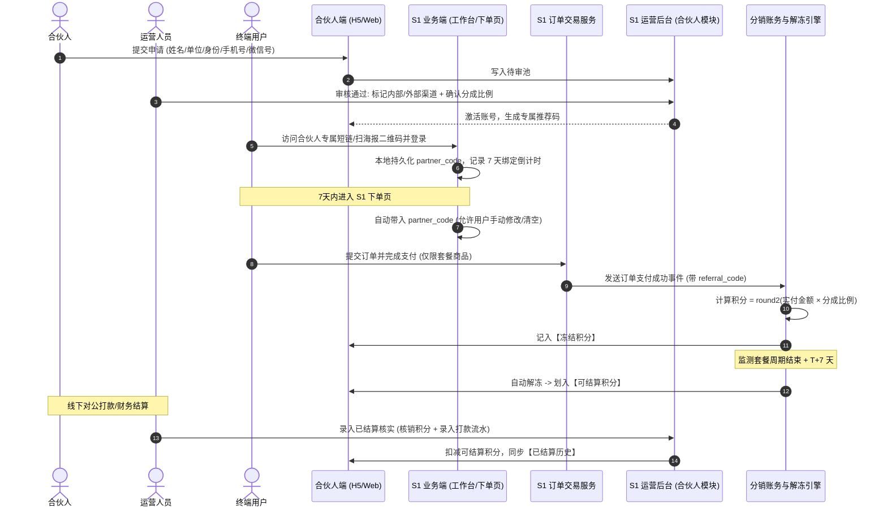

# 立理 S1 运营后台（合伙人管理模块）功能需求文档

| 项目 | 内容 |
| :--- | :--- |
| **文档版本** | V1.0 |
| **所属系统** | 立理 S1 运营管理后台（Admin Backoffice） |
| **功能模块** | 合伙人分销与渠道管理子系统（含 S1 交易网关配套改造） |
| **文档状态** | 待评审 / 待开发 |
| **编写日期** | 2026-11-03 |
| **适用终端** | PC 端运营管理平台（Web） |

---

## 1. 模块概述与系统集成定位

### 1.1 建设背景与系统定位
本模块是立理 S1 运营后台的**核心增量子系统**，负责统一管控立理 S1 的合伙人准入、渠道分类、分成比例配置、推广归因计算、解冻调度以及线下结算核实。

本系统不替代财务线下实际出款，而是提供**合伙人全生命周期管理、佣金积分精准核算、防退款冻结管控及线下打款数据双向核销同步**的中枢底座。

### 1.2 跨系统业务数据流架构



---

## 2. 合伙人申请与资质审核管理

### 2.1 合伙人申请管理列表
- **页面路径**：`/admin/partners/applications`。
- **列表筛选项**：申请手机号、姓名、所属单位、申请时间范围、审核状态（审核中 / 已通过 / 已拒绝）。
- **列表字段**：
  - 申请编号（自增唯一 ID）
  - 申请人姓名
  - 所属单位
  - 身份属性（合伙人前台输入的自由文本，如“清华大学在读博士”、“高校教师”）
  - 申请手机号
  - 微信号（若未填显示“-”）
  - 提交申请时间
  - 当前状态（审核中、已通过、已拒绝）
  - 操作列：【审核通过】、【拒绝申请】、【查看/编辑详情】、【修改审核状态】
- **申请记录与资料维护**：
  - 同一手机号仅保留一条申请记录；申请人提交后不可再次提交，已拒绝申请也不允许重复申请。
  - 运营人员可在详情页修改真实姓名、所属单位、身份属性和微信号；申请手机号作为登录标识，不允许修改。
  - 修改申请资料不自动改变审核状态。系统记录修改人、修改时间及修改前后的字段值。

### 2.2 审核操作流规范（核心流程）

#### (1) 【审核通过】弹窗操作规范
点击【审核通过】按钮，弹出模态对话框，运营人员必须完成以下配置：
1. **渠道类型标记（必选）**：
   - 单选框：`内部渠道` 或 `外部渠道`。
   - 业务定义：用于运营报表维度的宏观统计与后续权限隔离。
2. **分成比例设定（必填）**：
   - **智能联动逻辑**：
     - 当选择“内部渠道”时，分成比例输入框**自动填充默认值 `15%`**。
     - 当选择“外部渠道”时，分成比例输入框**自动填充默认值 `30%`**。
   - **手动覆盖权限**：运营人员可对具体合伙人手动修改该数值（输入范围：$0.0\% \sim 100.0\%$，支持一位小数）。
3. **专属推荐码生成**：
   - 弹窗展示系统自动生成的合伙人专属推荐码（规则为 **4 位纯数字**，如 `8866`；号码池自动排除过滤含连续 4 如 `4444`、谐音忌讳如 `1414`、`7414` 等不吉利数字组合），支持运营人员手动指定个性化 4 位纯数字码（全局唯一性校验）。
4. **生效确认**：
   - 点击【确认通过】后，该申请状态更新为“已通过”，系统自动在合伙人底表中创建账户，激活该手机号的登录权限。

#### (2) 【拒绝申请】操作规范
- 点击【拒绝申请】按钮，弹出拒绝原因输入框。
- 拒绝原因必填，10~200 字，如“当前申请暂不符合本期合作要求”。
- 确认后申请状态更新为“已拒绝”；申请人可在申请状态页查看拒绝原因，但不能修改资料或再次提交申请。

#### (3) 审核状态修改规范
- 申请审核状态包含 `PENDING`（审核中）、`APPROVED`（已通过）、`REJECTED`（已拒绝）。
- 允许状态流转：`PENDING -> APPROVED`、`PENDING -> REJECTED`、`REJECTED -> APPROVED`。申请人不能自行修改审核状态。
- 运营人员可将已拒绝申请调整为已通过。该操作须完成与常规审核通过相同的渠道类型、分成比例和专属推荐码配置，并在确认后创建合伙人账户、激活手机号登录权限。
- 已通过后的合作权限变更通过合伙人账号状态（正常 / 已冻结 / 已清退）管理，不通过修改申请审核状态回退。
- 每次审核状态修改均记录操作人、操作时间、修改前后状态及原因，供审计追溯。

### 2.3 合伙人档案名册与生命周期管理
- **页面路径**：`/admin/partners/list`。
- **核心数据看板**：在册合伙人总数、内部渠道数、外部渠道数、本月产生总积分、本月已核销积分。
- **列表字段**：
  - 合伙人 ID、姓名、手机号、所属单位、身份、微信号
  - **渠道类型**（Badge 标签：内部渠道 / 外部渠道）
  - **专属推荐码**（4 位纯数字）
  - **当前分成比例**（百分比）
  - **当前客户总数**、**付费客户数**
  - **当前可结算积分**、**冻结积分**、**累计已结算积分**
  - **合伙人账号状态**（正常 / 已冻结 / 已清退）
  - 加入时间
  - 操作：【修改比例】、【重置密码】、【冻结/解冻推广】、【清退】、【查看明细】
- **状态与密码维护说明**：
  - **重置密码**：运营人员可为合伙人重置随机临时密码，并通过短信通知合伙人；合伙人登录后可自行重置。
  - **冻结推广**：冻结后，该合伙人无法登录合伙人系统，其专属链接和推荐码在 S1 下单页校验失效，不再产生新分润。历史已冻结和可结算积分予以保留。
  - **修改分成比例**：仅对修改之后产生的新订单生效，历史已产生的订单分佣积分不追溯重算。

---

## 3. S1 业务端（下单与交易链路）配套改造需求

为支撑合伙人分销逻辑，立理 S1 核心交易系统与 C 端 Web 前端需进行配套改造：

### 3.1 推广链接解析与 7 天归因时效机制
1. **短链解析与重定向**：
   - S1 部署短链网关：访问 `https://s1.liliai.cn/r/{partner_code}` 时，记录点击埋点，并重定向至 S1 落地页 `https://s1.liliai.cn/?ref={partner_code}`。
2. **客户端归因数据暂存**：
   - S1 Web 前端捕获 URL 中的 `ref` 参数，存入浏览器的 `Cookie` 与 `LocalStorage`，记录结构：
     ```json
     {
       "referral_code": "8866",
       "bind_timestamp": 1798934400000
     }
     ```
3. **用户登录/注册关联**：
   - 终端用户在携带 `ref` 的状态下完成注册或登录，前端将 `referral_code` 上报至用户服务，在合伙人系统的“我的客户”列表立即新增一条记录（记录添加时间与注册时间）。
4. **7 天有效期倒计时判定（核心逻辑）**：
   - 规则：以**用户最近一次通过该合伙人链接访问并登录的时间戳**为起点，有效期为严格的 7 个自然日（$7 \times 24$ 小时）。
   - **7 天之内进入 S1 下单页**：系统自动在结算页面的“推荐码”输入框中回显该 `referral_code`。
   - **第 8 天及之后进入 S1 下单页**：判定 7 天已过期，下单页的“推荐码”输入框**默认留空**。
   - **重新激活逻辑**：用户若在第 8 天再次点击该合伙人的推广链接登录 S1，则重新刷新绑定时间戳，恢复新的 7 天默认带入期。
5. **多合伙人冲突归因**：
   - 遵循**末次覆盖原则**。用户若在第 1 天点击合伙人 A 链接，第 3 天点击合伙人 B 链接，则本地及用户态覆盖更新为合伙人 B 的推荐码，并重新起算 7 天。
6. **终端用户最终决策权**：
   - S1 下单页面的推荐码输入框完全支持用户手动修改为其他推荐码，或直接删除清空。最终订单以**支付提交时表单内的有效推荐码**为准。

### 3.2 S1 下单页面（Checkout）前端表单改造

```
+-------------------------------------------------------------+
|  商品：立理 S1 Pro 月卡 (首购)                   金额：¥299.00 |
+-------------------------------------------------------------+
|  合伙人推荐码: [ 8866        ]  [ 校验 / 修改 ]              |
|  (已默认带入推荐码，支持修改或清空)                            |
+-------------------------------------------------------------+
|  实际支付：¥299.00                                          |
|  [ 立即微信支付 / 支付宝支付 ]                                |
+-------------------------------------------------------------+
```

- **前端输入校验**：
  - 用户手动修改推荐码时，失焦异步调用后端校验接口 `/api/partner/validate-code?code=xxx`。
  - 若推荐码有效且所属合伙人状态为“正常”，提示绿色图标“推荐码有效”；若不存在或已冻结，提示红字“推荐码不存在或已停用”。
  - 允许留空提交订单。

### 3.3 核心订单表字段扩充

在 S1 订单数据模型（`orders` 表）中增加以下关键分销字段：

| 字段名称 | 类型 | 说明 |
| :--- | :--- | :--- |
| `referral_code` | VARCHAR(32) | 下单时实际生效的推荐码（无则为空） |
| `partner_id` | BIGINT | 归属合伙人唯一标识 ID |
| `partner_channel_type` | VARCHAR(16) | 下单时该合伙人的渠道类型（`INTERNAL` / `EXTERNAL`） |
| `commission_rate` | DECIMAL(5,4) | 下单时锁定的分成比例快照（如 `0.3000`） |
| `commission_points` | INT | 本单计算出的分成积分数额 |
| `commission_status` | VARCHAR(16) | 分成状态：`FROZEN`（冻结中）/ `UNFROZEN`（已解冻）/ `VOID_REFUND`（退款作废） |
| `unfreeze_scheduled_at` | DATETIME | 计划解冻时间戳（套餐到期日 + 7 天） |

---

## 4. 分润账务与解冻计算引擎

### 4.1 分销标的物与计算规则
1. **参与分润的商品范围**：
   - **严格限定为个人付费套餐**：Lite 月卡、Pro 月卡、Max 月卡、Lite 年卡、Pro 年卡、Max 年卡。
   - **增值加油包（ADDON）不计入分销**：加油包属于按需资源充值，不参与合伙人分成。
   - **机构大单（ORG_ANNUAL）不走线上分润**：由线下商务与销售团队单独跟进。
2. **分成计算基准**：
   - 严格以**订单实付金额（`payable_amount`）**为计算基准。
   - 计算公式：
     $$\text{commission\_points} = \text{round2}(\text{payable\_amount} \times \text{commission\_rate})$$
     （四舍五入保留两位小数，精确到分）。

### 4.2 续费与复购间隔保护机制（召回激励）
- **核心业务规则**：终端用户若连续按月/按年不间断续费，合伙人不享受持续“躺赢”分佣。
- **流失召回判定策略**：
  - 系统配置“**复购分佣冷却期（默认 90 天）**”。
  - 当绑定的老用户发起新的套餐下单时，系统检查其上一笔套餐订单的到期时间：
    - 若“当前下单时间 - 上期套餐到期时间 < 90 天”（属于连续或短期主动复购），则该笔订单**不产生分润积分**（`commission_points = 0`）。
    - 若“当前下单时间 - 上期套餐到期时间 $\ge$ 90 天”（属于用户流失后再次被合伙人召回促成），且下单时带有该合伙人的有效推荐码，则**正常计入分成**。

### 4.3 冻结与自动解冻调度任务（防退款核心）
为防止终端用户在购买后申请退款产生佣金坏账，设立自动化冻结期：

1. **初始状态入库**：订单支付成功后，分润流水入库，初始状态为 `FROZEN`（冻结中）。
2. **解冻时间计算公式**：
   $$\text{unfreeze\_scheduled\_at} = \text{benefit\_end\_at} + 7 \text{ 天}$$
   - *示例 1（月卡）*：用户于 11 月 29 日购买 Pro 月卡，套餐到期时间为 12 月 29 日。计划解冻时间为 12 月 29 日 + 7 天 = **次年 1 月 5 日**。
   - *示例 2（年卡）*：用户于 2026 年 11 月 3 日购买 Lite 年卡，套餐到期时间为 2027 年 11 月 3 日。计划解冻时间为 2027 年 11 月 10 日。
3. **定时解冻调度器（Cron Job）**：
   - 每日凌晨 01:00 自动执行一次调度任务。
   - 查询 `unfreeze_scheduled_at <= NOW()` 且 `commission_status = 'FROZEN'` 的流水记录。
   - 执行解冻事务：
     - 将流水状态变更为 `UNFROZEN`（已解冻）。
     - 合伙人账户汇总表：`withdrawable_points += commission_points`（可结算积分增加），`frozen_points -= commission_points`（冻结积分扣减）。

### 4.4 订单退款逆向作废
- 当 S1 核心订单发生退款时，触发退款事件监听。
- 系统检索关联的分销流水记录：
  - 若状态为 `FROZEN`，直接将状态置为 `VOID_REFUND`（退款作废），将合伙人账户的 `frozen_points` 扣除对应数额，积分**直接清零作废**。
  - 若发生罕见的人工特殊退款且流水已解冻，系统记录异常警报并记入“待追回积分”待线下扣减。

---

## 5. 线下结算管理与核实确认

合伙人的佣金兑现采用**线下人工管理与打款**的方式。本模块负责支撑财务对账与后台核销。

### 5.1 结算管理台账与导出
- **页面路径**：`/admin/partners/settlements`。
- **功能要素**：
  - 展示所有当前“可结算积分 $> 0$”的合伙人列表。
  - 列表字段：合伙人姓名、所属单位、身份、手机号、微信号、渠道类型（内部/外部）、累计总积分、**当前可结算积分**、历史已结算积分。
  - **批量导出财务打款表（Excel）**：
    - 运营/财务人员勾选指定合伙人，点击【导出打款清单】。
    - 导出的表格包含：合伙人姓名、手机号、微信号、渠道分类、应结算积分数值、开户行信息/线下约定打款方式（线下采集）、核对签名列。

### 5.2 线下结算确认操作（核销闭环）

```
+--------------------------------------------------------------+
| 确认线下结算核销                                               |
+--------------------------------------------------------------+
| 合伙人姓名：李教授 (139****1234)                               |
| 当前可结算积分：5,600.00                                       |
|                                                              |
| * 本次核销积分：[ 5600.00    ]  (支持全额或部分核销)             |
| * 财务打款凭证号：[ BCM2026110300892    ] (必填，转账流水单号)   |
|   结算经办人：财务王会计                                       |
|   打款备注说明：[ 2026年10月度推广服务费，招商对私转账已付 ]    |
+--------------------------------------------------------------+
|                     [ 取消 ]    [ 确认核销并同步 ]             |
+--------------------------------------------------------------+
```

1. **核销操作流**：
   - 财务线下完成转账打款后，运营在后台选中该合伙人，点击【确认已结算】。
   - 填写核销积分数额（系统默认自动填入其全部可结算积分，支持部分核销）。
   - **必填打款凭证流水号**（作为审计依据），并填写打款附言。
2. **系统联动更新**：
   - 点击确认后，事务执行：
     1. 该合伙人的 `withdrawable_points`（可结算积分）扣减核销数额。
     2. `settled_points`（累计已结算积分）累加核销数额。
     3. 插入一条结算履约台账（`partner_settlement_logs`）。
   - **合伙人端实时同步**：合伙人端工作台首页的“可结算积分”立即扣除，并在“已结算历史”列表中新增一条带有凭据流水号的已结算记录。

---

## 6. 运营报表与渠道数据统计

### 6.1 渠道类型对比大盘（内部渠道 vs 外部渠道）
- **维度对比图表**：
  - **规模指标**：合伙人总数、累计发展客户总数、月卡新购数、年卡新购数。
  - **财务指标**：总带单 GMV、总产生积分、总核销结算积分、未解冻沉淀积分。
  - **效率指标**：渠道平均单人带单量、客单价、月卡转年卡率。
- **报表导出**：支持按月份导出内部渠道与外部渠道的月度运营经营报表。

### 6.2 合伙人业绩风云榜（TOP 排行）
- 支持按月度、季度、年度查看合伙人带单榜：
  - TOP 合伙人排行榜（展示：排名、合伙人姓名、单位、渠道类型、带单金额、产生积分）。
  - 支持直接一键跳转至该合伙人的详细客户列表与带单订单穿透页。

---

## 7. 待讨论事项与后续规划（Open Issues）

> [!NOTE]
> 本章节记录当前版本暂未完全定性、需后续业务评审进一步明确的设计议题：

### 7.1 套餐升级补差价订单的分佣处理策略探讨
- **背景事实**：立理 S1 支持月卡升级高档月卡/年卡，其升级公式为“按未消耗积分比例折算抵扣旧订单金额，用户仅需支付差额（`payable_amount`）”。
- **待定方案对比**：
  - **方案 A（按实付差额计入分润）**：
    - 规则：升级订单依然视作套餐订单，以实际补交的实付差额金额乘以合伙人分成比例，产生新的冻结积分。
    - 优点：合规合理，合伙人有动力引导客户从 Lite 低档向 Pro/Max 升级。
    - 难点：需判断该升级订单的推荐码是归属于原合伙人还是新的推荐码。
  - **方案 B（升级订单不参与分销）**：
    - 规则：分销仅在用户首次购买月卡/年卡时分润一次，升级行为被视为平台内部自然留存升级，不计算二次分润。
    - 优点：财务逻辑与退款计算极为简单，完全避免多重嵌套折算。
- **建议推进方式**：V1.0 初期建议采用**方案 A（仅按实付差额计算分佣，解冻时间按升级后的新套餐到期日 + T+7 重新计算）**，如业务倾向极简则可先按方案 B 落地。
